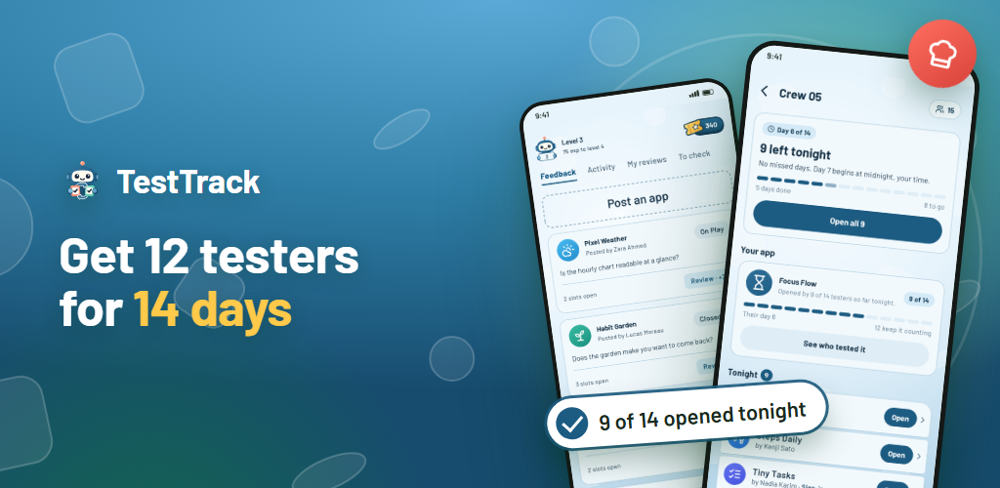

<p align="center">
  
</p>

# TestTrack

If you have a new personal developer account on Google Play, you can't publish to production
until your app has been through a closed test: at least 12 testers, opted in, for 14 days in a row.
For a solo developer that is the hardest part of shipping. You don't have twelve people, and the
ones you do have forget to open the app by day four.

TestTrack solves it by putting developers in the same position together. Everyone needs testers,
and everyone can be one. So you test other people's apps, and they test yours.

<p align="center">
  <a href="https://play.google.com/store/apps/details?id=com.eazyverse.testtrack">
    
  </a>
</p>

## How it works

**Crews.** A crew is fifteen developers, each bringing one app that is in closed testing. While the
crew fills, members install each other's apps from Play, and an app that won't install for others
is sent back to its owner to fix before anyone's fortnight starts. Once all fifteen seats are taken,
the crew starts at midnight in each member's own time zone.

For the next fourteen days, every member opens the other fourteen apps once a day. The visit is
proven by the phone's own usage records, not by a button anyone can tap, and it takes about ten
seconds per app. Missing one day earns a warning; missing two in a row takes your app out of the
crew. Fifteen seats for a requirement of twelve means a run still counts if a couple of people
drop away.

**Feedback.** Opening an app every day satisfies Google, but it doesn't tell you whether the app
is any good. In the Circle you can ask other developers to actually use your app and write to you
about it: what worked, what confused them, what broke. Each piece of feedback comes with a
screenshot from inside the app, so you can see it was really used. You approve it, or raise a
dispute that other members settle.

**Tix.** Taking a seat in a crew and asking for feedback both cost tix, the app's own credit. You
earn tix by giving feedback to others. Nothing is bought with money, and nobody can buy their way
past doing the work.

## How it helps

- **You reach production.** A finished crew is fourteen days of real, opted-in testers, which is
  exactly what Google asks for.
- **Your testers stay.** Everyone in a crew needs the same thing from everyone else, so they keep
  opening your app for the same reason you keep opening theirs.
- **You hear from people who build apps.** Feedback comes from other developers, who know the
  difference between a bug and a preference and tend to say which one they found.
- **It stays honest.** Visits are measured by Android, reports need two members to agree, and
  disputes go to members who weren't involved.

## Where it's available

TestTrack is free on [Google Play](https://play.google.com/store/apps/details?id=com.eazyverse.testtrack)
for phones running Android 8.0 or later. You can look around without an account; joining a crew or
asking for feedback needs a Google sign-in and membership of the testers group, which the app walks
you through.

## Privacy

Screenshots and profile pictures go to your own Google Drive, not to our servers; we keep only a
reference to the file. Anyone holding a screenshot's link can open it, so check what's in the
picture before you send it. Crew visits send how long an app was open, never what was on screen.

[Privacy policy](https://eazyverse.com/apps/testtrack/privacy) ·
[Request account deletion](https://eazyverse.com/apps/testtrack/delete-account)

## Building from source

This repository is the Android app, written in Kotlin with Jetpack Compose. The server it talks to
is a separate project.

You'll need Android Studio with JDK 17 or newer.

1. Copy `local.properties.example` to `local.properties` and fill in the values it describes.
2. Add a `google-services.json` from your own Firebase project to `app/`, with an Android app
   registered for `com.eazyverse.testtrack.debug` and your debug key's SHA-1. Google sign-in won't
   work without it.
3. Run `./gradlew installDebug`.

Before sending a change, run the same checks the project uses:

```sh
python scripts/check_app.py
./gradlew ktlintCheck testDebugUnitTest lintDebug
```

[docs/architecture.md](docs/architecture.md) explains how the app is put together, and
[docs/app-rules.md](docs/app-rules.md) the few rules the code follows.

## Contributing

Bug reports, ideas and pull requests are all welcome. Keep a pull request to one change and say how
you tested it. Please don't commit credentials, keys or `google-services.json`; they're already
ignored.

If you find a security problem, email [hello@eazyverse.com](mailto:hello@eazyverse.com) instead of
opening a public issue.

## License

TestTrack is released under the [MIT License](LICENSE). The Barlow and IBM Plex Mono fonts it
bundles are under the SIL Open Font License ([docs/licenses](docs/licenses)).

Made by [EazyVerse](https://eazyverse.com).
