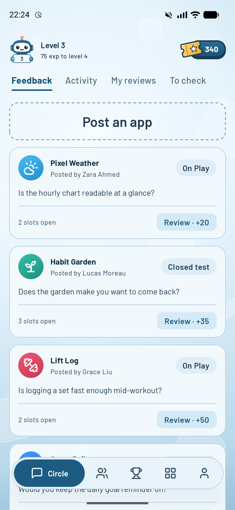
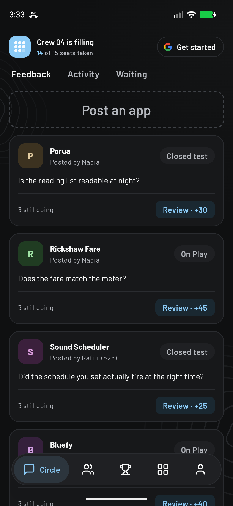
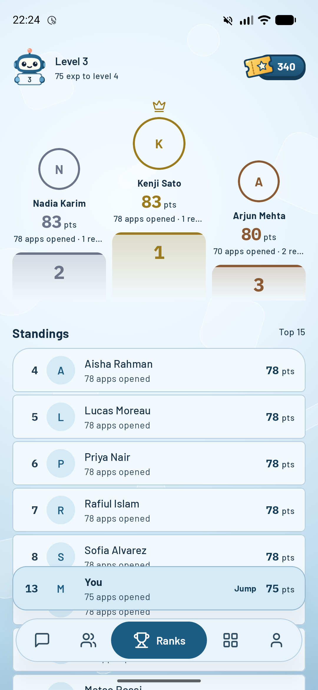

# TestTrack

TestTrack helps Android developers get through Google Play's closed testing and trade real feedback
on each other's apps.

New personal developer accounts must run a closed test with at least 12 testers for 14 days before
they can publish to production. TestTrack puts 15 developers in a **crew**: each one opens the other
14 apps every day for 14 days, and the phone's own usage records prove every visit. In the
**Circle**, developers ask for written feedback on their apps and pay for it in **tix**, the app's
own credit, earned by giving feedback to others.

<p align="center">
  
  
  
</p>

[Get it on Google Play](https://play.google.com/store/apps/details?id=com.eazyverse.testtrack)

## What's in the app

- **Circle**: feedback requests, a reviewer's step-by-step flow (install from Play, use the app,
  write private feedback, attach a screenshot), owner approval and community-judged disputes.
- **Crew**: open crews to join, the lobby where members check each other's apps install, the nightly
  round with a floating timer over each app, and a record of finished runs.
- **Ranks**: community standing from opens and accepted feedback.
- **My apps** and **Profile**: your apps, your crews and requests, and account settings.

Guests can browse the public screens before signing in.

## Privacy

Proof screenshots and profile pictures upload to the signed-in user's own Google Drive; the server
keeps references, not images. **Anyone with a proof link can view it**, so the app asks people to
check a screenshot and hide personal details before sending. Crew visits send usage durations,
never images. Installs and usage are reported by the phone; the server enforces the rules on time,
membership, permissions and payments.

[Privacy policy](https://eazyverse.com/apps/testtrack/privacy) ·
[Request account deletion](https://eazyverse.com/apps/testtrack/delete-account)

## Building

Requirements: Android Studio with JDK 17 or newer, and the Android SDK (compile SDK 37, min SDK 26).

1. Copy `local.properties.example` to `local.properties` and fill in the values it lists: the SDK
   path, a Google OAuth web client ID, the membership check URL and the testers group URL.
2. Add `app/google-services.json` from your own Firebase project, with an Android app registered for
   `com.eazyverse.testtrack.debug` and your debug signing SHA-1. Google sign-in fails without it.
3. Build and install a debug build:

```powershell
.\gradlew.bat installDebug
```

Debug builds talk to the production API by default (`API_BASE` in `app/build.gradle.kts`). The API
itself lives in a separate, private repository.

## Project layout

| Path | What it holds |
|---|---|
| `app/src/main/java/.../ui` | Compose screens and their view models |
| `app/src/main/java/.../viewmodel` | State shared across screens, such as the nightly round |
| `app/src/main/java/.../domain` | Pure rules with no Android dependencies |
| `app/src/main/java/.../data` | Device, Firebase, Drive and usage access |
| `app/src/main/java/.../net` | The API client and its wire types |
| `docs/` | Architecture, code rules, verification and design sources |
| `firestore.rules`, `firestore-tests/` | Rules for the legacy Firestore records, and their tests |
| `store/` | The Play listing, release notes and store art sources |

Read [architecture](docs/architecture.md) and [app rules](docs/app-rules.md) before changing the
app. The layering rules are enforced by `scripts/check_app.py`.

## Checks

```powershell
python scripts/check_app.py
.\gradlew.bat ktlintCheck testDebugUnitTest assembleDebug compileDebugAndroidTestKotlin lintDebug
```

Instrumented tests run on an emulator; see [verification](docs/verification.md).

## Contributing

Issues and pull requests are welcome. Keep each change focused, run the checks above, and describe
what you tested. Never commit credentials, signing keys, tokens or `google-services.json`; the
`.gitignore` already excludes them.

To report a security problem, email [hello@eazyverse.com](mailto:hello@eazyverse.com) rather than
opening a public issue.

## License

[MIT](LICENSE) © EazyVerse. The bundled Barlow and IBM Plex Mono fonts are under the SIL Open Font
License; see [docs/licenses](docs/licenses).
